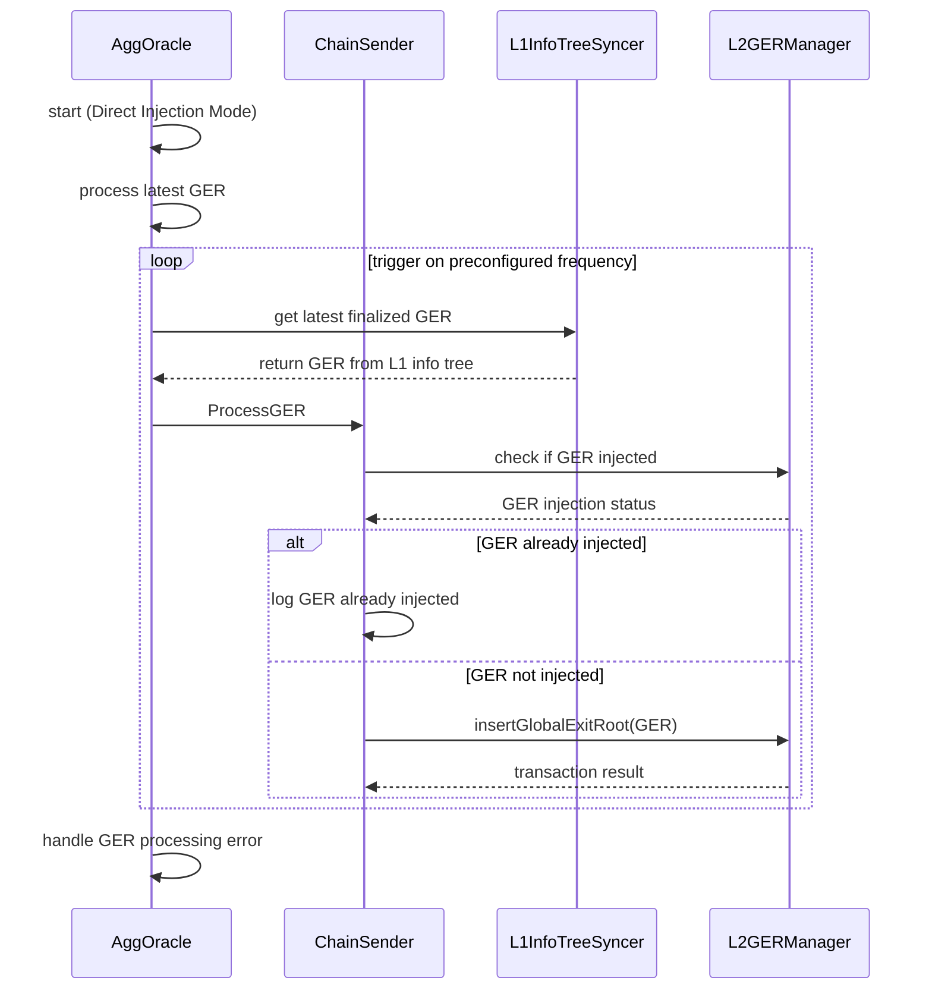
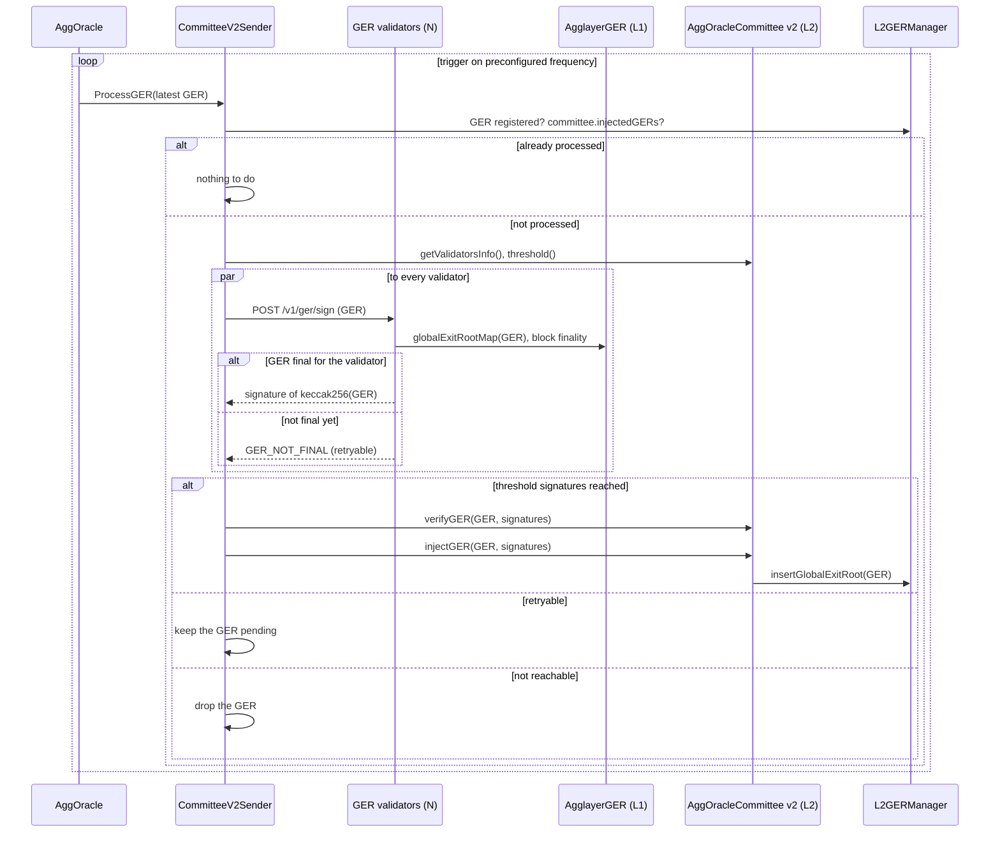

# AggOracle Component

## Overview

The **AggOracle** component ensures the **Global Exit Root (GER)** is propagated from L1 to the L2 sovereign chain smart contract. This is critical for enabling asset and message bridging between chains.

The GER is indexed from the L2 smart contract by **L2GERSyncer** component and persisted in local storage.

The AggOracle supports two operational modes, selected with `AggOracle.Mode`:

1. **Direct Injection Mode** (`direct`): Direct injection of GERs into the L2 GER Manager contract
2. **Committee Mode** (`committee`): A single transaction injects the GER together with the signatures of a threshold of GER validators, that sign off-chain (AggOracleCommittee v2)

The mode `auto` (the default) inspects the contract that is the GER updater of the L2 and selects one of them.

> **⚠️ The support of the old AggOracleCommittee (v1) was removed.** In that committee every member (one AggOracle each) proposed the same GER, and the contract injected it when a quorum was reached. Its mode (`legacy`), the `EnableAggOracleCommittee` option and the code that supported it are gone. A chain whose `globalExitRootUpdater` is a v1 committee must be migrated to an AggOracleCommittee v2 (`committee`) or to an EOA (`direct`) before upgrading: aggkit detects the v1 and refuses to start, with an error that says so. See [the removal of the v1](#6-removal-of-the-aggoraclecommittee-v1).

### Key Components:

- `ChainSender`: Interface for submitting GERs to the smart contract.
- `EVMChainGERSender`: An implementation of `ChainSender` for the direct injection mode.
- `CommitteeV2Sender`: An implementation of `ChainSender` for the committee mode. It collects the signatures of the GER validators.
- `gervalidator`: The client and the signature collector of the GER validators (see [GER validator signer](./gervalidator.md)).
- `DetectGERMode`: Detects the mode from the contract that is the GER updater of the L2.

---

## Workflow

### What is Global Exit Root (GER)?

The **Global Exit Root** consolidates:

- **Mainnet Exit Root (MER)**: Updated during bridge transactions from L1.
- **Rollup Exit Root (RER)**: Updated when verified rollup batches are submitted via ZKP.

        GER = hash(MER, RER)

### Operational Modes

#### 1. Direct Injection Mode

In this mode, the AggOracle directly injects GERs into the L2 GER Manager contract:

1. **Fetch Finalized GER**: AggOracle retrieves the latest GER finalized on L1.
2. **Check GER Injection**: Confirms whether the GER is already stored in the smart contract.
3. **Direct Injection**: If missing, AggOracle directly submits the GER via the `insertGlobalExitRoot` function.
4. **Sync Locally**: L2GERSyncer fetches and stores the GER locally for downstream use.

#### 2. Committee Mode (AggOracleCommittee v2)

In this mode there are two kinds of actors: **one AggOracle per chain**, and **many GER validators** (`ger_validator_signer`), that can serve many chains. The validators don't send transactions: only the AggOracle, with the account that is the `proposer` of the committee contract, writes on the L2.

1. **Fetch Finalized GER**: AggOracle retrieves the latest GER finalized on L1.
2. **Check GER Status**: Nothing to do if the GER is already in the L2 GER Manager, or the committee already processed it (`injectedGERs`): the committee never processes a GER twice, not even if it was removed from the L2 GER Manager afterwards.
3. **Read the Committee**: The validators (address and URL) and the `threshold` are read from the contract on every attempt, so changes of the committee are picked up. That is, when there is a new GER to inject (the latest GER is checked every `WaitPeriodNextGER`) and, while a GER is pending, every `CollectRetryInterval`: if no new GER comes, the committee is not read. At startup the committee is logged (version, proposer, L2 GER Manager, threshold and validators with their URL and where it comes from), and every change seen afterwards is logged as a warning (threshold, validators added or removed, URLs, order).
4. **Collect Signatures**: AggOracle asks all the validators, in parallel, to sign the GER, and stops as soon as it has `threshold` valid signatures. Each validator looks the GER up in `AgglayerGER.globalExitRootMap` on L1 and signs `keccak256(GER)` only if the L1 block that inserted it is canonical and final for its own finality configuration.
5. **Verify**: AggOracle calls `verifyGER` (a view) before spending gas.
6. **Inject**: AggOracle sends `injectGER(ger, signatures)`. The contract verifies the signatures, marks the GER as processed and calls `insertGlobalExitRoot` on the L2 GER Manager.
7. **Sync Locally**: L2GERSyncer fetches and stores the GER locally for downstream use.

What the contract requires from the signatures, and what AggOracle guarantees:

- Exactly `threshold` signatures of 65 bytes, concatenated (`r`, `s`, `v`). `v` must be 27 or 28 and `s` in the lower half of the curve order. AggOracle normalizes `v` (the validators can return 0 or 1) and rejects the signatures with a high `s`.
- The signers must be different validators, in **strictly ascending order of address**. AggOracle orders them.
- AggOracle recovers the signer of every signature and accepts it only if it is the validator that provided it, so a validator can't make the transaction revert by sending a signature of another one.
- The committee that verifies is the one at the moment the transaction is mined. If the validators or the threshold changed after they were read, the transaction reverts with `InvalidSignaturesLength`, `ValidatorDoesNotExist` or `ValidatorsNotOrdered`: AggOracle detects it with `verifyGER` and collects the signatures again (`MaxInjectAttempts`).

**Pending GERs.** A validator can require more finality than the AggOracle, so it can refuse a GER that is not final for it yet. While a GER is pending the AggOracle doesn't restart the collection with the newer GERs: it keeps asking for the pending one (every `CollectRetryInterval`) until it is injected, enough validators reject it (they say it is unknown or its block is not canonical, so it is dropped and the next tick takes the latest GER) or `PendingGERTimeout` expires. Skipping the intermediate GERs is safe: a later GER includes the exits of the previous ones. Only one GER is processed at a time in this mode.

**Security considerations.**

- The signature is `keccak256(GER)`, with no chain id nor contract address: it is valid in any committee that has the validator. That is what lets the same validators serve many chains. Don't reuse the key of a validator across environments.
- A GER that was injected by another updater and then removed from the L2 GER Manager before the committee processed it can be signed again by the validators, because they only look at L1. If it was processed by the committee it can't be injected again.

The sequence diagrams below depict the interactions in each operational mode.

#### Direct Injection Mode:



#### Committee Mode:



---

## Key Components

### 1. AggOracle

The `AggOracle` fetches the finalized GER and ensures its injection into the L2 smart contract using the configured operational mode.

#### Functions:

- **`Start`**: Periodically processes GER updates using a ticker.
- **`processLatestGER`**: Fetches the latest GER and delegates processing to the ChainSender.

---

### 2. ChainSender Interface

Defines the interface the AggOracle needs from the sender of every mode. How a GER ends up on the L2 depends on the mode, so each mode is a different implementation.

```go
// IsGERInjected returns true if the GER is already registered on the chain
IsGERInjected(ger common.Hash) (bool, error)
// ProcessGER does what is needed to get the GER registered on the chain
ProcessGER(ctx context.Context, ger common.Hash) error
```

---

### 3. EVMChainGERSender (direct injection)

Implements `ChainSender` for the direct injection mode, using Ethereum clients and transaction management.

#### Functions:

- **`IsGERInjected`**: Verifies GER presence in the L2 GER Manager contract.
- **`ProcessGER`**: Injects the GER with `InjectGER`.
- **`InjectGER`**: Directly submits the GER using `insertGlobalExitRoot` and monitors transaction status.

#### Validation:
- Validates that the sender address (the account of the EthTxManager) is authorized as `GlobalExitRootUpdater`

---

### 4. CommitteeV2Sender

Implements `ChainSender` for the AggOracleCommittee v2 (see [the flow](#2-committee-mode-aggoraclecommittee-v2)).

#### Validation at startup:
- The contract is an AggOracleCommittee v2 (`version()` starts with `v2.`) of the configured L2 GER Manager, and it is the `globalExitRootUpdater` of that L2 GER Manager.
- The account of the EthTxManager is the `proposer()` of the committee: only the proposer can call `injectGER`.
- At least `threshold` validators have a URL, registered in the contract or set in `AggOracle.CommitteeV2.ValidatorURLOverrides`.

---

### 5. Mode selection

`AggOracle.Mode` selects how the GERs are injected. `direct` is used as configured, without reading the L2. `committee` takes the committee from `AggOracleCommitteeAddr` or, if it is not set, from the `globalExitRootUpdater` of the L2 GER Manager (and both must be the same contract). `auto` reads the `globalExitRootUpdater` of the L2 GER Manager and decides:

| `globalExitRootUpdater` | Mode |
|---|---|
| The zero address (the L2 GER Manager accepts `block.coinbase`), an account without code, or an account delegated with EIP-7702 | `direct` |
| A contract whose `version()` starts with `v2.`, with `agglayerGERL2()` pointing to the L2 GER Manager, and `threshold()` and `proposer()` | `committee` |
| A contract whose `VERSION()` starts with `v1.`, with `globalExitRootManagerL2Sovereign()` pointing to the L2 GER Manager, and `quorum()` | error: the AggOracleCommittee v1 is not supported anymore |
| Anything else (a multisig, a committee of another version or of another L2 GER Manager, a contract that matches both) | error: set `Mode` explicitly |

An RPC failure while detecting is an error at startup: it is never interpreted as "the contract is not a v2 committee". If `AggOracleCommitteeAddr` is set it must be the `globalExitRootUpdater`; if it is only the pending updater, the error says that `acceptGlobalExitRootUpdater()` must be called first.

### 6. Removal of the AggOracleCommittee v1

The old AggOracleCommittee (v1) is **not supported anymore**: the `legacy` mode, the sender that proposed the GERs to it, its tests and the `EnableAggOracleCommittee` option were removed.

- **A v1 is still detected, only to say so.** With `Mode = "auto"`, a chain whose `globalExitRootUpdater` is a v1 committee fails at startup with an error that names the contract and its version and tells how to migrate, instead of an "unknown contract" error. With `Mode = "committee"` the contract must be a v2.
- **`EnableAggOracleCommittee` is ignored.** It is not a field anymore: a configuration that still has it (with `false`, as many do) only logs a warning at load, and with `true` the chain is refused as above if it has a v1.
- **Migration.** Before upgrading, the `globalExitRootUpdater` of the L2 GER Manager has to be an AggOracleCommittee v2 (and the [GER validators](./gervalidator.md) have to be running), or an EOA. There is no upgrade from the v1 contract to the v2 contract.

---

## Smart Contract Integration

### 1. L2 GER Manager Contract

Used in both modes for final GER storage and status checking.

- **Contract**: `GlobalExitRootManagerL2SovereignChain.sol`
- **Key Functions**:
  - `insertGlobalExitRoot`: Final GER injection (called directly in Direct Mode, or by the committee contract in Committee Mode)
  - `GlobalExitRootMap`: Check if a GER is already injected
  - `GlobalExitRootUpdater`: Get authorized updater address (for Direct Mode validation)
- **Source Code**: [zkevm-contracts](https://github.com/0xPolygonHermez/zkevm-contracts/blob/feature/audit-remediations/contracts/v2/sovereignChains/GlobalExitRootManagerL2SovereignChain.sol#L89-L103)
- **Bindings**: Available in [cdk-contracts-tooling](https://github.com/0xPolygon/cdk-contracts-tooling/tree/main/contracts/pp/l2-sovereign-chain)

### 2. AggOracleCommittee v2 Contract

Used in the committee mode. It replaced the v1 contract in the same Solidity file and with the same name, so the bindings of the v1 and of the v2 are not interchangeable: aggkit needs a version of `cdk-contracts-tooling` generated from the v2 (see below).

- **Contract**: [`AggOracleCommittee.sol` (v2.0.0)](https://github.com/agglayer/agglayer-contracts/blob/v13.0.0-rc.0/contracts/sovereignChains/AggOracleCommittee.sol)
- **Key Functions**:
  - `injectGER(bytes32 ger, bytes signatures)`: verifies the signatures, marks the GER as processed and inserts it in the L2 GER Manager. Only the `proposer` can call it.
  - `verifyGER(bytes32 ger, bytes signatures)`: the same verification as a view. It returns `true` or reverts.
  - `getValidatorsInfo()`, `threshold()`, `proposer()`, `injectedGERs(bytes32)`, `agglayerGERL2()` and `version()`.
- **Errors AggOracle relies on**: `GERAlreadyInjected`, `InvalidSignaturesLength`, `ValidatorDoesNotExist` and `ValidatorsNotOrdered`.
- **Bindings**: package `aggoraclecommittee` of [cdk-contracts-tooling](https://github.com/0xPolygon/cdk-contracts-tooling/tree/main/contracts/aggchain-multisig/aggoraclecommittee), generated from [agglayer-contracts v13.0.0-rc.0](https://github.com/agglayer/agglayer-contracts/releases/tag/v13.0.0-rc.0). A test (`committee_v2_abi_test.go`) checks the selectors that AggOracle relies on.
- **Migration**: there is no upgrade from v1 ([it is not supported anymore](#6-removal-of-the-aggoraclecommittee-v1)). A chain moves to v2 by changing the `globalExitRootUpdater` of its L2 GER Manager to the v2 committee.

---

## Configuration

### Selecting the mode

```toml
[AggOracle]
# direct | committee | auto (default)
Mode = "auto"
```

### Committee Mode Configuration

```toml
[AggOracle]
TargetChainType = "EVM"
WaitPeriodNextGER = "5s"
Mode = "committee"

[AggOracle.EVMSender]
GlobalExitRootL2 = "0x123...abc"        # L2 GER Manager contract address
# Optional: if it is not set, the GER updater of the L2 GER Manager is used
AggOracleCommitteeAddr = "0x456...def"
# The account of the EthTxManager must be the proposer() of the committee

[AggOracle.CommitteeV2]
RequestTimeout = "5s"          # to every validator
CollectRetryInterval = "5s"    # before asking the validators again when the threshold was not reached
MaxInjectAttempts = 3          # failed attempts (the committee changed, the tx failed) before giving up with a GER
PendingGERTimeout = "0s"       # how long a GER is kept pending: 0 is until it is injected or dropped
# Validators with no URL registered in the contract, or whose URL must be replaced
ValidatorURLOverrides = [
  { Address = "0x0000000000000000000000000000000000000001", URL = "https://ger-validator-1.example.com" },
]
[AggOracle.CommitteeV2.TLS]
CACertFile = ""                # a CA that is not in the system store
ClientCertFile = ""            # mutual TLS: both or none
ClientKeyFile = ""
```

### Direct Injection Mode Configuration

```yaml
AggOracle:
  TargetChainType: "EVM"
  URLRPCL1: "https://eth-mainnet.g.alchemy.com/v2/your-api-key"
  WaitPeriodNextGER: "5s"
  Mode: "direct"
  EVMSender:
    GlobalExitRootL2: "0x123...abc"  # L2 GER Manager contract address
    AggOracleCommitteeAddr: "0x000...000"  # Not used in direct mode
    GasOffset: 80000
    WaitPeriodMonitorTx: "1s"
    EthTxManager:
      FrequencyToMonitorTxs: "1s"
      WaitTxToBeMined: "2m"
      # ... other EthTxManager config
```

### Key Configuration Differences

| Configuration | Direct Injection Mode | Committee Mode |
|---------------|---------------------|----------------|
| `Mode` | `direct` | `committee` |
| `AggOracleCommitteeAddr` | Not required | Optional (defaults to the GER updater) |
| `EthTxManager.From` | Must be authorized as `GlobalExitRootUpdater` | Must be the `proposer()` of the committee |
| **GER Submission** | Direct via `insertGlobalExitRoot` | One `injectGER` with the signatures of `threshold` validators |
| **Transactions per GER** | 1 | 1 |
| **Other components** | None | `ger_validator_signer` instances (no transactions) |

---

## 📊 Aggoracle Metrics

The **Aggoracle** service exposes Prometheus metrics to track Global Exit Root (GER) processing activity, latency, and error rates.
All metrics are registered under the namespace: `aggoracle`

| Metric | Type | Description | Unit |
|---------|------|--------------|------|
| `aggoracle_ger_processing_trigger_total` | Counter | Total number of GER processing triggers. | count |
| `aggoracle_ger_processing_errors_total` | Counter | Total number of GER processing errors. | count |
| `aggoracle_ger_processing_duration_seconds` | Histogram | Time taken to process a single Global Exit Root from start to finish. | seconds |

## Summary

The **AggOracle** component automates the propagation of GERs from L1 to L2, enabling bridging across networks. It supports two operational modes, that can be selected or detected automatically:

- **Direct Injection Mode**: Simple, single-authority GER injection
- **Committee Mode**: Validators that are independent of the destination chain sign the GER off-chain, and a single transaction injects it with the signatures of a threshold of them

Refer to the EVM implementations in [evm.go](https://github.com/agglayer/aggkit/blob/develop/aggoracle/chaingersender/evm.go) and [committee_v2.go](https://github.com/agglayer/aggkit/blob/develop/aggoracle/chaingersender/committee_v2.go) for guidance on building chain senders for non-EVM chains.
