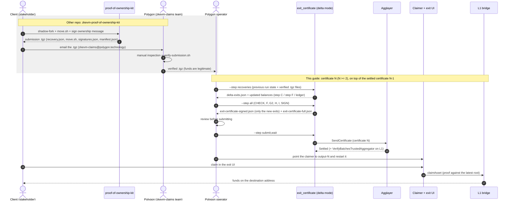
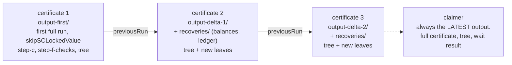

# Exit certificate of a deprecated chain: recovering SC-locked funds (delta mode)

> **Scope.** This guide is about the **exit certificate** of a chain that has been **closed (deprecated)** and is
> leaving the Agglayer: the one produced **manually** by the
> [`exit_certificate` tool](../tools/exit_certificate/README.md) to bridge all the value of the L2 back to L1. It has
> **nothing to do with the regular certificates** that a live chain's [aggsender](./aggsender.md) builds and sends to
> the agglayer automatically.

When the exit certificate of a deprecated chain is generated, the **SC-locked funds** (value held by smart
contracts, which have no private key that can sign a bridge) are not bridged to anyone: they are
left behind (`options.skipSCLockedValue`) or sent to a single `exitAddress`. Later, the real owners of those funds
can prove ownership (see [zkevm-proof-of-ownership-kit](https://github.com/agglayer/zkevm-proof-of-ownership-kit)).
The **delta mode** is the mechanism to **add the bridge exits that release SC-locked funds to their rightful owners**
after the first exit certificate of the deprecated chain has settled. This guide explains exactly how to use it and
what to do when something does not add up. For the full reference of the tool see the
[exit_certificate README](../tools/exit_certificate/README.md#delta-mode--chain-additional-exits-on-a-previous-certificate);
for the claimer, the [exit_certificate_claimer README](../tools/exit_certificate_claimer/README.md).

- [Quick start](#quick-start)
- [End-to-end flow](#end-to-end-flow)
- [When to use it](#when-to-use-it)
- [Concepts](#concepts)
- [Procedure A — add one or several exits](#procedure-a--add-one-or-several-exits)
- [Procedure B — add more exits later](#procedure-b--add-more-exits-later)
- [Verifying the result](#verifying-the-result)
- [Updating the claimer](#updating-the-claimer)
- [Troubleshooting](#troubleshooting)

## Quick start

Assumes **certificate 1** (the first full run of the tool, generated with `options.skipSCLockedValue=true`) is
already **Settled**, and that every recovery you are about to apply was **already verified by Polygon**
([end-to-end flow](#end-to-end-flow)). What follows creates **certificate N** (N ≥ 2) on top of the last settled
one (N-1). Run it in order; nothing is sent to the agglayer until step 5.

1. **Collect the verified cases**: put the `.tgz` files (one per client, as received) in a directory, e.g. `./cases`.
2. **Create the config** of certificate N: copy the config of the last settled run and set

   ```jsonc
   "options": {
       "deltaMode": true,
       "previousRun": "./output-N-1",     // output dir of certificate N-1 (must be Settled)
       "outputDir": "./output-N",         // new and empty
       "recoveriesPath": "./cases",
       "deltaExitsFile": "./output-N/recoveries/delta-exits.json"   // written by the next command
   }
   ```

3. **Turn the cases into exits** (writes only `output-N/recoveries/`):

   ```bash
   ./target/exit_certificate --config parameters.json --step recoveries
   ```

   Read `output-N/recoveries/recoveries-report.md` and `delta-exits.json`: they must be exactly the funds you expect.
   The step **refuses to run again** into the same `output-N` (it would overwrite the state and drop the earlier
   cases): if another `.tgz` arrives before you generate the certificate, add it to `./cases`, delete
   `output-N/recoveries/` and run it again — every case of this certificate goes in one run.
4. **Generate certificate N** (CHECK → F → G2 → H → I → SIGN; it does **not** send it):

   ```bash
   ./target/exit_certificate --config parameters.json
   ```

   It needs `signerConfig` to sign: without it the run succeeds but **`exit-certificate-signed.json` is not
   written** (the tool warns) and step 5 would fail.

   Then run the [checks before submitting](#before-submitting-files-of-the-delta-output-dir).
5. **Send it and wait for settlement** (irreversible):

   ```bash
   ./target/exit_certificate --config parameters.json --step submit,wait
   ```

   Done only when `output-N/step-wait-result.json` says `Settled`.
6. **Point the claimer at `output-N`** and restart it ([Updating the claimer](#updating-the-claimer)): the clients
   can now claim on L1.
7. **More recoveries later?** Repeat from step 1 with `previousRun: "./output-N"` and a new `outputDir`. Keep every
   old output directory.

If a command fails, nothing was written (`recoveries`) or nothing was sent (steps 3–4): fix the cause and run it
again. Failures and what to do: [Troubleshooting](#troubleshooting).

## End-to-end flow

Who does what, from the client's submission to the funds on L1. The first part happens **in another repository**
([zkevm-proof-of-ownership-kit](https://github.com/agglayer/zkevm-proof-of-ownership-kit)); this guide starts when a
verified `.tgz` reaches the operator that runs the `exit_certificate` tool.



| # | Who | What | Where it is covered |
| - | --- | ---- | ------------------- |
| 1–3 | Client | Simulates the recovery on a shadow-fork, signs, and submits the `.tgz`. | kit repo (`submission/SUBMIT.md`) |
| 4–5 | Polygon | Inspects and verifies the submission: signatures, the simulated move and `recovery.json`. Whoever passes it makes the **legitimacy** call. | kit repo (`submission/verify-submission.sh`) |
| 6–7 | Operator | `--step recoveries`: the `.tgz` files plus the previous run's balance state become the delta exits file and the updated balances. Refuses a case applied twice and anything above what the first certificate left behind. | [Quick start 1–3](#quick-start), [exit_certificate README](../tools/exit_certificate/README.md#recoveries-step--from-verified-recoveries-to-delta-exits) |
| 8–9 | Operator | Generates and signs certificate N (only the new exits) chained on N-1. | [Procedure A](#procedure-a--add-one-or-several-exits) |
| 10–13 | Operator | Reviews, submits, waits for `Settled`. | [Verifying the result](#verifying-the-result) |
| 14 | Operator | Repoints the claimer to the new output directory. | [Updating the claimer](#updating-the-claimer) |
| 15–17 | Client | Claims on L1 through the exit UI. | [exit_certificate_claimer README](../tools/exit_certificate_claimer/README.md) |

What chains from certificate to certificate (one output directory each; the previous one is never modified):



Two things travel down the chain, and both must be present in the `previousRun` of the next certificate:
the **exit tree** (`step-g-l2bridgesyncerlite.sqlite`, which gets the new leaves appended) and the **balance state**
of the recoveries (`recoveries/`: updated `step-c-sc-locked-values.json` and `step-f-checks.json`, plus the ledger
that stops a case from being applied twice). The claimer only needs the latest one.

## When to use it

A full run of the tool produces **one** exit certificate for the deprecated chain. If more exits must be issued
afterwards (typically **SC-locked funds** that the first exit certificate left behind with `skipSCLockedValue`,
whose owners later proved ownership), do **not** re-run the full pipeline: the new certificate would have to
restart from the already settled LER, and the L2 scan does not contain recovery exits. Use the delta mode: it
builds an exit certificate containing **only the new exits**, chained on the previous settled one. It can be
repeated; the output of every delta is a valid input for the next.

It is **not** for: chains that are still operating (their certificates come from aggsender), nor for adding exits
that are not SC-locked funds without a prior decision of the team (the tool only checks balances, not who is
entitled to them: that verification is a manual, off-chain prerequisite).

## Concepts

| Term | Meaning |
| ---- | ------- |
| certificate N | The exit certificate this guide builds. Certificate 1 is the first full run; every delta is certificate 2, 3, … chained on the previous one (N-1). |
| previous run | Output dir of the last **settled** run (certificate N-1: the first full run, or the last delta). Never modified. |
| delta exits file | JSON with the new exits (`bridge_exits`), e.g. the release of SC-locked funds to their verified owners. One run takes as many as needed. |
| delta exit certificate | `exit-certificate-signed.json` of the delta run: **only** the new exits. It is what is submitted. |
| full certificate | `exit-certificate-full.json`: every exit (previous + new, in leaf order) with the latest `new_local_exit_root`. Not submittable; input of the next delta and of the claimer. |
| exit tree | `step-g-l2bridgesyncerlite.sqlite`. The delta copies the previous one and **appends** leaves: old leaves keep their deposit count, so the `globalIndex` of old exits never changes. |

Rules that always apply:

1. The previous certificate must be **Settled** (`step-wait-result.json` of the previous run exists and says so).
2. There must be **no pending certificate** for the network.
3. The agglayer's settled LER must be the previous certificate's `new_local_exit_root`, i.e. the previous run is
   the **latest** settled certificate of the chain. Two deltas cannot be prepared in parallel on the same base.
4. `options.outputDir` must differ from `options.previousRun`. Use a **fresh, empty** dir for each attempt.

## Procedure A — add one or several exits

### 1. Get the delta exits file

For SC-locked funds the file is **generated from the verified recoveries** (next subsection). It can also be written
by hand. All the exits of this run go in one file, with the same shape as a certificate's `bridge_exits`:

```json
{
  "bridge_exits": [
    {
      "leaf_type": "Transfer",
      "token_info": { "origin_network": 0, "origin_token_address": "0x0000000000000000000000000000000000000000" },
      "dest_network": 0,
      "dest_address": "0x00000000000000000000000000000000000000d1",
      "amount": "1000000000000000000"
    },
    {
      "leaf_type": "Transfer",
      "token_info": { "origin_network": 0, "origin_token_address": "0x<erc20-origin-token>" },
      "dest_network": 0,
      "dest_address": "0x00000000000000000000000000000000000000d2",
      "amount": "250000000"
    }
  ]
}
```

Constraints (validated on load; the run fails before touching anything):

- Only `Transfer` exits, with `amount` > 0 and a `token_info`.
- `dest_network` must not be the exiting network itself.
- `metadata` is optional and is the **raw** leaf metadata (plain hex: no `0x` prefix, even length — anything else is
  rejected; the tool hashes it). Do **not** copy the `metadata` of a certificate's `bridge_exits`: that one is the
  keccak hash. Leave it out unless you know it: the tool then derives it from the L2 bridge as `bridgeAsset` does
  (name/symbol/decimals of the L2 token for ERC-20, gas-token metadata for native) — which needs the L2 RPC.
- **No two identical exits** (same token, destination, amount and metadata), neither inside the file nor against
  **any leaf already in the exit tree** (exits of previous runs and the older L2 bridges): they share a leaf hash and
  the claimer could not tell them apart. Merge repeated exits of the file into one summing the amounts; if it
  equals an already settled leaf, change the amount (e.g. split it in two different amounts).
- Per token, the sum of the new exits must be ≤ the remaining balance the agglayer holds for that token
  (`admin_getTokenBalance`, already net of previous certificates). See [troubleshooting](#step-f-delta-exits-exceed-the-agglayer-remaining-balance).

#### Generating the exits from verified recoveries (the usual way)

The exits are produced from the recoveries the
[zkevm-proof-of-ownership-kit](https://github.com/agglayer/zkevm-proof-of-ownership-kit) already verified. Set
`options.recoveriesPath` (directory, `.tgz` or `recovery.json`) in the delta config and run
`./target/exit_certificate --config parameters.json --step recoveries`. It writes
`<outputDir>/recoveries/delta-exits.json` (use it as `deltaExitsFile`) and the updated balance state
(`step-c-sc-locked-values.json`, `step-f-checks.json`, the ledger `recoveries-applied.json` and a report).
It refuses to apply a case twice and checks, per token, that what is recovered fits in the SC-locked value the
first certificate left behind. Rules worth knowing:

- **One recovery per (locked contract, token), ever.** The ledger cannot tell a re-packaged copy of an applied case
  from a new one, so a contract+token that already has a recovery is refused (also two cases for it in the same
  batch). Consequence: a contract that holds funds of several owners (vault, pool, multisig) can be recovered once
  per token.
- **One case per archive**, and each case once per batch: an archive with more than one `recovery.json`/`move.sh`
  is an error, and so is a directory that holds both a kit `.tgz` and its extracted `recovery.json` (a loose
  `recovery.json` without `move.sh` hashes only itself, so it would not look like the same case as the `.tgz`).
- The step **never overwrites** an earlier run into the same `outputDir` (see the quick start). Whether each case is legitimate is **not** checked: that is the manual
verification that must precede it. Details in the
[exit_certificate README](../tools/exit_certificate/README.md#recoveries-step--from-verified-recoveries-to-delta-exits).

### 2. Create the delta config

Copy the config of the previous run and set:

```jsonc
"options": {
    "deltaMode": true,
    "previousRun": "./output-first",         // output dir of the LAST settled run
    "deltaExitsFile": "./delta-exits.json",  // with recoveries: ./output-delta-1/recoveries/delta-exits.json
    "outputDir": "./output-delta-1",         // new, must differ from previousRun
    "recoveriesPath": "./cases"              // only for --step recoveries: verified .tgz files
}
```

The usual `l2RpcUrl`, `l1RpcUrl`, `agglayerClient` (gRPC), `agglayerAdminURL` and `signerConfig` are still needed.
`exitAddress` is not required in delta mode. Delta-specific rules:

- **The L2 RPC must still answer** (`l2RpcUrl`): the tool reads the L2 bridge's gas token and, for every exit
  without `metadata` (all of those produced by `--step recoveries`), the L2 token's name/symbol/decimals. Balances are
  never read from it. Today delta mode cannot run without it: if the chain's RPC is gone, restore a node (or an
  archive of the L2 state) before generating the delta.
- `useAgglayerAdminToStepFCheck` must be `true` (Step F is the only check of the amounts against the agglayer).
- `ignoreLERMismatch` is rejected (the delta is chained on `previousRun` by construction), and
  `ignoreBalanceMismatch`/`capMode` do not apply (an excess always fails).
- `signerConfig` is needed to get `exit-certificate-signed.json`.

### 3. Generate the delta certificate

```bash
./target/exit_certificate --config parameters.json
```

This runs `CHECK → F → G2 → H → I → SIGN`. In delta mode only `all` (default), `sign`, `submit` and `wait` exist.

| Step | What it does |
| ---- | ------------ |
| CHECK | Prerequisites + chaining: agglayer `settled_ler` == previous `new_local_exit_root`, next height == previous + 1, no pending certificate. |
| F | Per token, `sum(new exits) ≤` remaining agglayer balance. |
| G2 | Copies the previous tree, checks its root against the previous certificate, appends the new leaves continuing the deposit counts, takes the new root. |
| H | `prev_local_exit_root` = previous `new_local_exit_root`, `height` = previous + 1 (cross-checked with the agglayer). |
| I, SIGN | Unchanged. |

**Stop here and verify** ([next section](#verifying-the-result)) **before submitting**. Submitting is the
irreversible step.

### 4. Submit and wait for settlement

```bash
./target/exit_certificate --config parameters.json --step submit,wait
```

`wait` polls until the certificate is `Settled` and confirms the `VerifyBatchesTrustedAggregator` event on L1. It
writes `step-wait-result.json`; the run is **not usable as `previousRun` until that file says Settled**.

### 5. Update the claimer

See [Updating the claimer](#updating-the-claimer).

## Procedure B — add more exits later

Repeat Procedure A with the **latest settled run** as the base:

| Delta | `previousRun` | `outputDir` |
| ----- | ------------- | ----------- |
| 1 | output of the first full run | `output-delta-1` |
| 2 | `output-delta-1` | `output-delta-2` |
| n | `output-delta-(n-1)` | `output-delta-n` |

- A new delta file contains **only the new exits** of that round. Do not repeat the ones already issued.
- Wait for delta n-1 to be **Settled** before generating delta n. If you generate it earlier, CHECK fails
  (see [AET-11](#check-aet-11-the-agglayer-settled-ler-is-not-the-previous-certificates-new_local_exit_root)).
- `previousRun` can be the dir of a regular run (its signed certificate already holds every exit) or of a delta (its
  full certificate is used).
- Old exits keep their `globalIndex`. Users that claimed before a delta settles do not need to do anything; claims
  after it are proven against the latest root.

## Verifying the result

### Before submitting (files of the delta output dir)

| Check | How |
| ----- | --- |
| The delta carries only the new exits | `jq '.bridge_exits \| length' exit-certificate-signed.json` equals the number of exits in your delta file (delta mode never trims them). |
| Height chains | `jq .height exit-certificate-signed.json` == previous height + 1. |
| Roots chain | `jq .prev_local_exit_root exit-certificate-signed.json` == previous `new_local_exit_root`; `new_local_exit_root` is different. |
| Nothing old was touched | `diff <(jq -S '.bridge_exits[0:N]' exit-certificate-full.json) <(jq -S .bridge_exits <previous cert>)` is empty (N = previous exit count). |
| Full certificate is complete | `jq '.bridge_exits \| length' exit-certificate-full.json` == previous count + delta count; its `new_local_exit_root` == the delta's. |
| `delta-manifest.json` is coherent | `rootBefore` == previous `new_local_exit_root`; `rootAfter` == delta `new_local_exit_root`; `firstDepositCount` ≥ previous exit count; `lastDepositCount - firstDepositCount + 1 == deltaExitCount`; `totalExitCount` == previous count + `deltaExitCount`; `previousCertificateHeight`/`deltaCertificateHeight` consecutive. |
| Amounts and destinations are the intended ones | Compare `bridge_exits` of the signed certificate against your delta file (`step-f-*` files show any capping). |

`test/e2e-exit_certificate/52-generate_delta_certificate.sh` performs exactly these checks and is a runnable reference.

### After submitting

```bash
./tools/exit_certificate/scripts/agglayer_certificate_status.sh -n <network_id> --wait \
    --expected-ler <delta new_local_exit_root>
```

It polls until the agglayer's settled LER is the delta's `new_local_exit_root`. Also check that
`step-wait-result.json` has `finalStatus` Settled and the L1 `VerifyBatchesTrustedAggregator` data.

### After updating the claimer

- `list-bridges.sh <dest_address>` shows the new exits for their destination, and the old ones with the **same**
  deposit count as before.
- `/claim-params` for a new exit returns a proof; the claimer verifies it against the settled `new_local_exit_root`
  before returning it. An error here means the claimer files do not belong to the settled delta (see below).

## Updating the claimer

Point the claimer at the **latest delta** (the full run's outputs are no longer enough):

| Claimer setting | Value |
| --------------- | ----- |
| `signedCertificatePath` | `<latest delta>/exit-certificate-full.json` (**not** `-signed.json`: it only holds the delta's exits) |
| `localExitTreeDBPath` | `<latest delta>/step-g-l2bridgesyncerlite.sqlite` |
| `stepWaitResultPath` | `<latest delta>/step-wait-result.json` |
| `pendingBridgesPath` | unchanged (only if you use PENDING_CLAIMS) |

With `--exit-certificate-config <delta config>` (`options.deltaMode=true`) the three paths are derived
automatically. Then:

1. Restart the claimer with the new paths (docker: the volumes/paths of the compose file must point at the latest
   delta dir). Restarting is the safe option; do not assume it reloads files by itself.
2. `claim-all.sh`: pass the latest delta's output dir. It claims the EOAs of the first scan, `exitAddress` and,
   when `exit-certificate-full.json` exists, **every L1 destination of it** (so delta recipients are covered). With
   a delta config, whose output dir has no `step-b-eoa-balances.json`, set `EOA_FILE` to the first run's file.
3. Keep the previous dirs: the claimer only needs the latest, but they are the audit trail and the base for the
   next delta.

## Troubleshooting

First, **where** it failed tells you what is wrong. The delta never modifies `previousRun`, so any failure before
`submit` can be fixed and retried from scratch (new empty `outputDir`). Failures after `submit` need the agglayer
state first (`agglayer_certificate_status.sh`).

### Before generating

| Symptom (error text) | Cause | What to do |
| -------------------- | ----- | ---------- |
| `delta exit N: …` / `leaf_type … not supported` / `amount must be positive` / `dest_network … is the exiting network itself` | Invalid exit in the delta file | Fix that exit. |
| `delta exits file … has no bridge_exits` | Empty or wrong shape | Check the JSON has a `bridge_exits` array. |
| `options.outputDir and options.previousRun must be different directories` | Same dir | Use a new `outputDir`. |
| `load previous run … (the previous certificate must be submitted and settled)` | `step-wait-result.json` missing in `previousRun` | The previous run never reached `wait`. Run `--step submit,wait` on it (or point `previousRun` at the right dir). |
| `previous certificate … is not settled (status …)` | Previous certificate not settled | Wait for it, or see "Certificate InError" below. |
| `previous run local exit tree DB … not found` | Sqlite missing in `previousRun` | Restore it from backup. If it is lost, the tree must be rebuilt from the certificate: do not guess, ask the team. |
| `delta exit N (…) is identical to … : identical leaves share a hash` | Identical exit repeated, or equal to a leaf already in the tree | Merge repeated exits of the delta file into one, summing the amounts. If it equals a leaf of a **previous** run or an older L2 bridge (already settled, it cannot be merged), change the amount so the leaf differs (e.g. issue it as two different amounts). |
| `delta exit N: metadata must be plain hex without the 0x prefix` / `… is not valid hex` | `0x` prefix, odd length or non-hex `metadata` in the delta file | Write the raw metadata as plain even-length hex, or remove the field to derive it from the L2 bridge. Never paste a certificate's `metadata` (it is a hash). |
| `options.ignoreLERMismatch is not supported with options.deltaMode` | The option is set in a delta config | Remove it. If the settled state differs from `previousRun`, fix `previousRun` instead. |
| `step F (delta) requires options.useAgglayerAdminToStepFCheck=true` | Admin check disabled | Enable it and set `agglayerAdminURL`: delta mode does not allow skipping Step F. |
| `… already holds the recoveries of an earlier --step recoveries run for this delta` | `--step recoveries` run twice into the same `outputDir` | Put every case of the delta in `recoveriesPath`, delete `<outputDir>/recoveries/` and run it again (or use a new `outputDir`). |
| `the archive has more than one recovery.json` / `… carry the same recovery.json` | A kit `.tgz` with several cases, or a `.tgz` together with its extracted files | One case per archive; supply each case once. |
| `two different cases recovering … in this same batch` / `already recovered … (recoveries ledger)` | The same locked contract + token twice (re-packaged case, or a second owner of the same vault) | See "One recovery per (locked contract, token)" above. |

### CHECK: AET-11 — "the agglayer settled LER … is not the previous certificate's new_local_exit_root"

The agglayer's latest settled state is not the previous run's. Causes, in order of likelihood:

1. **The previous certificate is not settled yet.** Wait: `agglayer_certificate_status.sh -n <id> --wait --expected-ler <prev new_local_exit_root>`.
2. **`previousRun` is not the latest settled certificate.** Someone submitted another certificate (another delta, a
   regular certificate from aggsender) after it. Rebuild the delta on top of that one; if its output dir is not
   available, get it before going on. `ignoreLERMismatch` is rejected in delta mode on purpose: the resulting
   certificate would be built on a root the agglayer does not have and would be rejected.
3. **Wrong network id / wrong agglayer** in the config.

The same error says "the agglayer next certificate height is X but the previous certificate has height Y" when the
height does not follow: same actions (a certificate exists that is not in your `previousRun`).

### CHECK: "network N already has a pending certificate"

There is a certificate in flight (yours or another). Wait until it is Settled or InError and retry. Do not submit
over it.

### Step F: delta exits exceed the agglayer remaining balance

`EXCEEDS REMAINING BALANCE (network=… addr=…): delta=… agglayer remaining=…` and the run stops. The agglayer would
reject any certificate that exits more than the chain's remaining balance of that token.

1. Check what was already issued: sum of that token in the previous full certificate vs `admin_getTokenBalance`
   (`get-agglayer-lbt.sh`). A mismatch usually means a previous exit is being counted twice (the same funds
   requested in two deltas) or the amount in the file is wrong.
2. If the amount is wrong, fix the file and rerun.
3. **Capping is not available in delta mode** (`ignoreBalanceMismatch`/`capMode` are ignored here): the exits come
   from `--step recoveries`, whose ledger and balance state assume every one is paid in full, so trimming them would
   leave those files saying more was released than the certificate carries. If the agglayer genuinely cannot cover a
   recovery, stop and decide with the team before changing amounts by hand (and fix the recoveries state too).

Step F cannot be skipped either: `useAgglayerAdminToStepFCheck=false` is an error in delta mode.

### Step G2: "previous run is inconsistent: its local exit tree root … differs from the … new_local_exit_root"

The sqlite of `previousRun` does not correspond to its certificate (copied from another run, partially restored,
or a delta whose files were mixed). **Stop**: appending leaves would produce a root nobody can prove. Restore the
matching pair (certificate + sqlite) from the run that produced them; if that is impossible, escalate.

### Step G2: "append delta leaves to the exit tree: …" (gap/overlap)

The deposit counts did not continue from the tree's last leaf. The append is transactional: nothing was written.
The copy in the output dir is discarded when you retry with a fresh `outputDir`. If it persists with a clean
previous run, it is a bug: keep the output dir and report it.

### Step H

`agglayerClient.grpc.url is required for step H` or a height/LER cross-check error: same causes as AET-11.

### Submit: certificate rejected / "send certificate to agglayer"

Read the agglayer message. Typical: balance (see Step F), prev LER or height (see AET-11), or signature (the
`signerConfig` does not match the network's signer). Fix the cause and regenerate from scratch with a fresh
`outputDir`: do **not** edit the signed certificate by hand.

### Wait: "certificate … is in error"

The certificate went `InError`. Nothing was settled, the chain state is still the previous run's, and `previousRun`
is intact.

1. Get the error from `step-wait-result.json` / `agglayer_certificate_status.sh`.
2. Check the agglayer state: settled LER must still be the previous `new_local_exit_root`.
3. Fix the cause and **regenerate** the delta in a new `outputDir` (it is a new certificate, not a resubmit). The
   failed delta's output dir must **not** be used as `previousRun` for anything.
4. If the agglayer will not accept a new certificate for that height, it is an agglayer-side state to be handled by
   its operators, not something to work around in the tool.

### Wait: timeout / L1 confirmation errors

`context cancelled after …`: the certificate is still in progress; rerun `--step wait`, which polls the agglayer again, with a
longer timeout. `l1RpcUrl is required` / `set rollupManagerAddress …` / `no UpdateL1InfoTree event found`: config
or L1 RPC problem, rerun `wait` after fixing it; the certificate itself is not affected.

### Claimer

| Symptom | Cause | What to do |
| ------- | ----- | ---------- |
| `bridge exit[N] (leaf …) not found in local exit tree` | `signedCertificatePath` and `localExitTreeDBPath` belong to different runs (e.g. full certificate of delta 2 with the sqlite of delta 1) | Point both at the **same** latest delta dir. |
| `certificate new local exit root not settled in L1 info tree` / `… has local exit root …, certificate has …` | The L1 info tree has not yet got the delta's root, or `stepWaitResultPath` is from another run | Wait for the L1 info tree to sync, or point `stepWaitResultPath` at the latest delta's `step-wait-result.json`. |
| New exits missing in `/bridges` / `list-bridges.sh` | Claimer still using the old files (not restarted) or `signedCertificatePath` is `exit-certificate-signed.json` | Use `exit-certificate-full.json` and restart. |
| An old exit now has a different index | Should never happen: old leaves keep their deposit count | Stop. Compare the previous and new full certificates (`diff` of `bridge_exits[0:N]`) and the manifest's `firstDepositCount`; report it before any user claims. |
| A delta recipient is not claimed by `claim-all.sh` | Output dir passed has no `exit-certificate-full.json` | Run it against the latest delta dir. |

### Escalate when

- The root of the previous tree does not match its certificate and you cannot restore the right files.
- An old exit changes its deposit count/leaf.
- The agglayer reports a state (settled LER, height) you cannot map to any of your runs.
- A delta was submitted by mistake (wrong destination or amount) and settled: exits are final once settled; it
  cannot be undone from this tool. Report immediately, before the claims happen.
