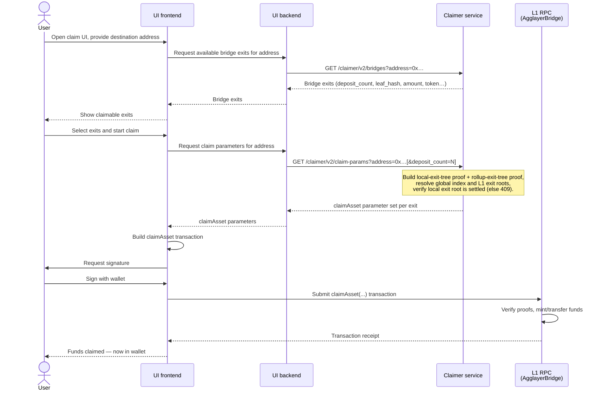

# Exit Certificate Claimer — Specification

## Purpose & Audience

This document specifies the end-to-end flow and the public contract of the
**exit certificate claimer**: the backend service that, given a destination address, returns the
bridge exits available for that address and the full set of parameters needed to call
[`AgglayerBridge.claimAsset`](https://github.com/agglayer/agglayer-contracts/blob/110bda5a03e70ee7331bc06407a8e79226d3e520/contracts/AgglayerBridge.sol#L537)
(or `AgglayerBridge.claimMessage`, for `Message` exits) on L1.

Stakeholders:

- **The `@apps-team`** — implementing the UI (frontend/backend).
- **The `@team-agglayer-aggkit`** — implementing the exit certificate claimer, which acts as the
  kind of bridge service.

## Scenario

This tool exists to support **deprecating (shutting down) an L2 network** while ensuring its users
can still recover their funds.

1. **Move the funds from L2 to L1.** Before the network is shut down, we generate one **final exit
   certificate** for it and send it to *Agglayer*. This is done with the
   [`exit_certificate`](../exit_certificate) tool, which both generates the certificate and submits
   it to Agglayer.
2. **Wait for the certificate to be `Settled`.** Once the certificate reaches the `Settled` state on
   L1, the L2 network being closed is no longer needed and can be **stopped** — from this point on,
   all claim operations happen on L1.
3. **Expose the claim API.** With the network stopped, we launch the **exit certificate claimer**,
   which exposes an API that lets users recover the funds they held on the deprecated network.

The flow described in this document covers step 3: how a user goes from wanting to claim those funds
to having them in their wallet on L1.

## Scope

In scope:

- The claim flow from a user wanting to recover funds that were on the zkEVM until those funds land
  in their wallet on L1.
- The HTTP API the claimer service exposes and the data it returns.

Out of scope (handled by other actors):

- Generating and signing the exit certificate (done by the
  [`exit_certificate`](../exit_certificate) tool).
- Building, signing, and submitting the `claimAsset` transaction (done by the UI + the user's
  wallet). The claimer service is **read-only**: it never sends transactions.

## Actors

| Actor | Description |
| ----- | ----------- |
| **User** | The owner of the funds. Interacts with the UI and signs the L1 `claimAsset` transaction with their wallet. |
| **UI frontend** | Browser/app the user interacts with. Talks to the UI backend and to the user's wallet. |
| **UI backend** | The UI team's server. Orchestrates calls to the claimer service on behalf of the frontend. |
| **Claimer service** | This tool. Read-only HTTP service that lists bridge exits and assembles `claimAsset` parameters from the signed certificate and the exit-tree / L1 Info Tree databases. |
| **L1 RPC** | The L1 node endpoint. Hosts the `AgglayerBridge` contract where `claimAsset` is called, and is also the source the claimer uses to keep its L1 Info Tree DB in sync. |

## End-to-End Flow

From the user wanting to claim funds that were on the zkEVM until those funds are in their wallet
on L1.



## HTTP API

The API is versioned in the path. This claimer serves one major version, **`/claimer/v2`**, which
returns `Transfer` and `Message` exits (`claimAsset` / `claimMessage`), looked up by `address`: the
exit's destination address or, for a `Message` exit of a configured message route, its beneficiary.
Every response is `application/json`.

The service is read-only: it never sends transactions.

### API versioning

- The major version is the `v<N>` of the base path. **A new major version is only added for a breaking
  change**: removing or renaming a field, a parameter or an endpoint, changing the type or meaning of
  a field, or returning entries an existing client cannot handle.
- Within a major version, changes are **additive only**: new optional query parameters, new fields in
  a response, new endpoints. Clients must ignore fields they do not know.
- The claimer and its UI (the claims UI) are deployed together, so only one major version is served at a
  time: there is no side-by-side period.
- Discovery: `GET /claimer/v2/health` returns `api_version` and `api_versions`, the list of major
  versions the claimer serves (`[2]`). Every v2 response, errors included, carries `api_version: 2`.
- The responses are pinned by golden files ([`service/testdata/api/`](service/testdata/api), checked by
  `TestAPIGolden`); `requests.json` there maps each file to its request and HTTP status. API clients can
  use them as contract fixtures.

#### API v1 (removed)

API v1 (`/claimer/v1`: `Transfer` exits only, looked up by `dest_address`) has been removed. Only
`GET /claimer/v1/health` is kept, so existing probes and monitoring keep working: it returns `status`,
`network_id`, `version`, `api_versions: [2]` and the `run` / `follow` objects of the v2 health. Any
other `/claimer/v1/*` path answers `410 Gone`:

```json
{ "error": "claimer API v1 has been removed, use /claimer/v2", "api_versions": [2] }
```

### Conventions

- Addresses and hashes are `0x`-prefixed hex strings. Addresses are EIP-55 checksummed.
- Amounts and the global index are decimal strings (they can exceed 64-bit range).
- `metadata` is a `0x`-prefixed hex string (`"0x"` when empty): always the **raw bridge metadata**, in
  `/bridges` and in `/claim-params`, for certificate exits and pending bridges alike, and every entry
  carries `metadata_hash`, its keccak256 hash.
- `Message` exits (`leaf_type` 1, created by `bridgeMessage`) are returned along with `Transfer` exits,
  and every entry says how to claim it (`claim_method`).
- Every response, errors included, carries `"api_version": 2`. On error, the body is
  `{"api_version": 2, "error": "<message>"}` with the corresponding HTTP status code.

### Which exits belong to an address

An exit matches `address` when:

1. `address` is its `destination_address` (any exit), **or**
2. it is a `Message` exit of a configured **message route** and `address` is the **beneficiary** decoded
   from its metadata.

A `Message` exit is addressed to the contract that receives the message, not to the holder it pays.
A message route (claimer config `messageRoutes`, see the [README](README.md#message-routes)) names the
origin `(network, address)` and the destination `(network, address)` of a kind of message and the layout
of its metadata — for now only `address,uint256`, i.e. `abi.encode(address beneficiary, uint256 amount)`
— plus the token the destination contract pays with. For such an exit the response adds `beneficiary`,
`decoded_amount` and `display_token`, so a client needs no knowledge of the contracts involved.

A message whose route is not configured, or whose metadata is not exactly that layout, is matched by
rule 1 only and carries none of those three fields.

Example (Circle USDC recovery on zkEVM): `ZkMinterBurner` (network 1) sends a message to `L1Escrow`
(network 0) with `metadata = abi.encode(holder, amount)`. `GET /claimer/v2/bridges?address=<holder>`
returns it with `claim_method: "claimMessage"`, `beneficiary: <holder>`, `decoded_amount` in USDC base
units and `display_token` = L1 USDC. Calling `claimMessage` with the parameters of `/claim-params`
makes `L1Escrow` pay the holder. Anyone can send that transaction.

### `GET /claimer/v2/health`

Liveness/readiness probe. Also reports the run being served and, in follow mode, its state (`run` and `follow`,
see [Run and follow fields of `/health`](#run-and-follow-fields-of-health)).

**Response — `200 OK`**

```json
{
  "api_version": 2,
  "status": "ok",
  "network_id": 1,
  "version": {
    "version": "v0.1.0",
    "git_rev": "abc1234",
    "git_branch": "feature/exit-certificate-tool",
    "build_date": "Mon, 30 Jun 2026 10:00:00 +0200",
    "go_version": "go1.22.0",
    "os": "linux",
    "arch": "amd64"
  },
  "api_versions": [2],
  "run": {
    "source": "gs://<bucket>/runs/1/0000000005",
    "height": 5,
    "certificate_hash": "0x…",
    "data_version": 1
  },
  "follow": {
    "interval_seconds": 60,
    "next_run": "gs://<bucket>/runs/1/0000000006",
    "next_height": 6,
    "last_check_time": "2026-11-25T10:00:00Z",
    "last_check_result": "no_new_run",
    "blocked_by_unsupported_version": false,
    "preparing": false,
    "last_switch_time": "2026-11-24T18:30:00Z"
  }
}
```

| Field | Type | Description |
| ----- | ---- | ----------- |
| `api_version` | number | Always `2`. |
| `status` | string | Always `ok`. The HTTP server only starts after the L1 Info Tree has been synced up to the certificate's settlement GER, so a reachable endpoint is always ready to serve claim requests. |
| `network_id` | number | The source network ID the claimer is serving. |
| `version` | object | Build/version info (same fields the exit_certificate tool prints in its startup banner): `version`, `git_rev`, `git_branch`, `build_date`, `go_version`, `os`, `arch`. Populated at build time via ldflags. |
| `api_versions` | number[] | Major API versions this claimer serves (see [API versioning](#api-versioning)): `[2]`. |
| `run` | object | The exit_certificate run being served (see below). |
| `follow` | object | State of follow mode (see below). **Absent when follow mode is disabled.** |

#### Run and follow fields of `/health`

Returned by `/claimer/v2/health` and by the kept `/claimer/v1/health` (an additive change: clients must
ignore fields they do not know, and must not require these).

`run` — the run being served. In follow mode it changes when the claimer switches run.

| Field | Type | Description |
| ----- | ---- | ----------- |
| `source` | string | Archive prefix of the run, `gs://<bucket>/<base>/<networkID>/<height>`. Absent when the claimer serves local files. |
| `height` | number | Height of the run's certificate. |
| `certificate_hash` | string | Agglayer hash of the run's certificate (from `step-wait-result.json`). |
| `data_version` | number | Data version of the archived run (its manifest's `dataVersion`). Absent when the claimer serves local files. |

`follow` — follow mode (the claimer looks for the run of the next height and switches to it on its own).

| Field | Type | Description |
| ----- | ---- | ----------- |
| `interval_seconds` | number | Seconds between checks. |
| `next_run` | string | Archive prefix the claimer looks for the next run at. |
| `next_height` | number | Its height: `run.height + 1`. |
| `last_check_time` | string | When the last check finished (RFC 3339, UTC). Absent before the first check. |
| `last_check_result` | string | Result of the last check (table below). Absent before the first check. |
| `blocked_by_unsupported_version` | boolean | `true` while the run at `next_run` exists but has a manifest or data version this claimer does not support: the claimer keeps serving `run` and needs an upgrade. |
| `preparing` | boolean | `true` while a new run is being downloaded, loaded or synced, before the switch. |
| `last_switch_time` | string | When the claimer last switched run (RFC 3339, UTC). Absent if it never did. |

| `last_check_result` | Meaning | Still serving `run`? |
| ------------------- | ------- | -------------------- |
| `no_new_run` | Nothing complete is archived at `next_run` (no manifest). The normal state. | yes |
| `switched` | The claimer switched to the run of the next height. Rarely seen: after a switch it checks the following height at once, which usually gives `no_new_run`; use `last_switch_time`. | yes (the new one) |
| `unsupported_version` | The next run has an unsupported manifest or data version. | yes |
| `lookup_failed` | The archive could not be read. | yes |
| `download_failed` | The next run could not be downloaded, or a file did not match its manifest. | yes |
| `load_failed` | The files of the next run could not be loaded or are not consistent (e.g. its certificate is not the one of that height). | yes |
| `l1_sync_failed` | The settlement of the next run could not be indexed in the L1 Info Tree. | yes |

Every result other than `switched` leaves the claimer serving the same run, and every failure is retried at
the next check. No error text is exposed here (it could carry internal URLs): the detail is in the logs.
`status` stays `ok` in all of them — the claimer keeps answering claim requests for the run it serves.

**Version policy of the archived data.** The manifest of an archived run carries `version` (manifest format)
and `dataVersion` (format of the run files: certificate JSON, exit-tree DB schema, `step-wait-result.json`,
`step-pending-l2-bridges.json`; absent = 1). A claimer supports a fixed range of each (today: 1 and 1). A run
outside it is refused at startup (the process exits with an error) and never switched to in follow mode
(`blocked_by_unsupported_version`). The exit_certificate tool bumps `dataVersion` whenever a change would
break an older claimer, so an old claimer never serves data it does not understand.

**What changes for a client when the claimer switches run.** The exits of the previous run are all in the new
one, with the same `deposit_count` and `global_index`; the new run adds exits. Claim parameters already
returned stay valid on L1 (they are anchored to the settlement of the run they came from); the ones returned
after the switch are anchored to the new run's settlement.

### `GET /claimer/v2/bridges`

**Query parameters:**

| Name | Required | Type | Description |
| ---- | -------- | ---- | ----------- |
| `address` | yes | hex address | The address to list bridge exits for (see [Which exits belong to an address](#which-exits-belong-to-an-address)). |

**Response — `200 OK`**

```json
{
  "api_version": 2,
  "network_id": 1,
  "address": "0xAbC0000000000000000000000000000000000001",
  "bridges": [
    {
      "leaf_type": 0,
      "origin_network": 0,
      "origin_token_address": "0x0000000000000000000000000000000000000000",
      "destination_network": 0,
      "destination_address": "0xAbC0000000000000000000000000000000000001",
      "amount": "2000000000000000000",
      "metadata": "0x",
      "deposit_count": 42,
      "metadata_hash": "0xc5d2460186f7233c927e7db2dcc703c0e500b653ca82273b7bfad8045d85a470",
      "claim_method": "claimAsset"
    },
    {
      "leaf_type": 1,
      "origin_network": 1,
      "origin_token_address": "0xBDa0B27f93B2FD3f076725b89cf02e48609bC189",
      "destination_network": 0,
      "destination_address": "0x70E70e58ed7B1Cec0D8ef7464072ED8A52d755eB",
      "amount": "0",
      "metadata": "0x000000000000000000000000abc0000000000000000000000000000000000001000000000000000000000000000000000000000000000000000000004995e400",
      "deposit_count": 43,
      "metadata_hash": "0x…",
      "claim_method": "claimMessage",
      "beneficiary": "0xAbC0000000000000000000000000000000000001",
      "decoded_amount": "1234560000",
      "display_token": {
        "address": "0xA0b86991c6218b36c1d19D4a2e9Eb0cE3606eB48",
        "symbol": "USDC",
        "decimals": 6
      }
    }
  ]
}
```

| Field | Type | Description |
| ----- | ---- | ----------- |
| `api_version` | number | Always `2`. |
| `network_id` | number | Source network ID. |
| `address` | hex address | Echo of the requested address. |
| `bridges[]` | array | One entry per matching exit: the certificate's exits first, in certificate order, then the pending pre-certificate bridges. Empty array when there is none. |
| `bridges[].leaf_type` | number | `0` = asset (`Transfer`), `1` = message (`Message`). |
| `bridges[].origin_network`, `bridges[].origin_token_address` | number, hex address | For an asset, the token's origin network and address. For a message, the network and address of the contract that sent it. |
| `bridges[].destination_network`, `bridges[].destination_address` | number, hex address | Destination of the exit. For a message it is the contract that receives it, **not** the beneficiary. |
| `bridges[].amount` | decimal string | The leaf's amount: the tokens transferred for an asset; the ETH value attached to a message (usually `"0"`). For what a decoded message pays, see `decoded_amount`. |
| `bridges[].metadata` | hex string | The **raw** bridge metadata of the leaf (`"0x"` when empty), for certificate exits and pending bridges alike. For an ERC-20 asset it is `abi.encode(name, symbol, decimals)`; for a message, its payload. |
| `bridges[].metadata_hash` | hex hash | keccak256 of `metadata`: the metadata slot of the exit-tree leaf, and what the certificate carries as the exit's metadata. Always present (the hash of the empty string for empty metadata). |
| `bridges[].deposit_count` | number | Exit-tree leaf index of this exit. Unique per exit: use it to select the exit in `/claim-params`. |
| `bridges[].claim_method` | string | `claimAsset` or `claimMessage`: the `AgglayerBridge` function that claims this exit. |
| `bridges[].beneficiary` | hex address | Only for a decoded message: the address the destination contract pays. |
| `bridges[].decoded_amount` | decimal string | Only for a decoded message: the amount paid to the beneficiary, in base units of `display_token`. |
| `bridges[].display_token` | object | Only for a decoded message: `address`, `symbol` and `decimals` of the token the beneficiary is paid in, as configured in the message route (not read on-chain). |

`beneficiary`, `decoded_amount` and `display_token` are present together or not at all.

### `GET /claimer/v2/claim-params`

**Query parameters:**

| Name | Required | Type | Description |
| ---- | -------- | ---- | ----------- |
| `address` | yes | hex address | Same selection as `/bridges`. |
| `deposit_count` | no | number (uint32) | Select a single exit by its exit-tree leaf index. When omitted, all the exits of the address are returned. An exit that does not belong to `address` is not returned (empty `claims`). |

**Response — `200 OK`**

```json
{
  "api_version": 2,
  "network_id": 1,
  "address": "0xAbC0000000000000000000000000000000000001",
  "claims": [
    {
      "smt_proof_local_exit_root": ["0x…", "… 32 sibling hashes …"],
      "smt_proof_rollup_exit_root": ["0x…", "… 32 sibling hashes …"],
      "global_index": "43",
      "mainnet_exit_root": "0xaaa…",
      "rollup_exit_root": "0xbbb…",
      "origin_network": 1,
      "origin_token_address": "0xBDa0B27f93B2FD3f076725b89cf02e48609bC189",
      "destination_network": 0,
      "destination_address": "0x70E70e58ed7B1Cec0D8ef7464072ED8A52d755eB",
      "amount": "0",
      "metadata": "0x000000000000000000000000abc0000000000000000000000000000000000001000000000000000000000000000000000000000000000000000000004995e400",
      "leaf_type": 1,
      "deposit_count": 43,
      "l1_info_tree_index": 7,
      "metadata_hash": "0x…",
      "claim_method": "claimMessage"
    }
  ]
}
```

Each entry in `claims[]` maps directly to the claim call. The first 11 fields are the contract
arguments; the rest are context useful for callers and debugging.

| Field | Type | Claim arg? | Description |
| ----- | ---- | ---------- | ----------- |
| `smt_proof_local_exit_root` | string[32] | yes | Merkle proof of the leaf against `new_local_exit_root`. |
| `smt_proof_rollup_exit_root` | string[32] | yes | Merkle proof against the rollup exit root. |
| `global_index` | decimal string | yes | Global index for `(network_id, deposit_count)`. |
| `mainnet_exit_root` | hex hash | yes | Mainnet exit root of the settlement L1 Info Tree leaf. |
| `rollup_exit_root` | hex hash | yes | Rollup exit root of the settlement L1 Info Tree leaf. |
| `origin_network` | number | yes | Asset: network the token originates from. Message: network of the sender contract. |
| `origin_token_address` | hex address | yes | Asset: origin token contract address. Message: the sender contract (`originAddress`). |
| `destination_network` | number | yes | Destination network ID. |
| `destination_address` | hex address | yes | Destination (recipient) address; for a message, the receiving contract. |
| `amount` | decimal string | yes | Transferred amount (a message's ETH value). |
| `metadata` | hex string | yes | Raw bridge metadata (`"0x"` when empty): pass it unchanged to the contract. |
| `leaf_type` | number | no (context) | `0` = asset, `1` = message. |
| `deposit_count` | number | no (context) | Exit-tree leaf index. |
| `l1_info_tree_index` | number | no (context) | The L1 Info Tree leaf the proofs are anchored to. |
| `metadata_hash` | hex hash | no (context) | keccak256 of `metadata`; same value as in `/bridges` for the same exit. |
| `claim_method` | string | no | `claimAsset` or `claimMessage`: the function to call. |

When the claimer is given the exit_certificate PENDING_CLAIMS step output (`pendingBridgesPath`),
`/bridges` and `/claim-params` also return, after the certificate's exits, the L2→L1 bridges emitted
before the certificate that were unclaimed on L1 when that step ran, with proofs against the
certificate's `new_local_exit_root` and the `global_index` of their own `deposit_count`.

`claimAsset` and `claimMessage` take the **same 11 arguments in the same order** — the first 11 fields
of the entry:

```solidity
function claimAsset  (bytes32[32] smtProofLocalExitRoot, bytes32[32] smtProofRollupExitRoot, uint256 globalIndex,
                      bytes32 mainnetExitRoot, bytes32 rollupExitRoot, uint32 originNetwork, address originTokenAddress,
                      uint32 destinationNetwork, address destinationAddress, uint256 amount, bytes metadata)
function claimMessage(bytes32[32] smtProofLocalExitRoot, bytes32[32] smtProofRollupExitRoot, uint256 globalIndex,
                      bytes32 mainnetExitRoot, bytes32 rollupExitRoot, uint32 originNetwork, address originAddress,
                      uint32 destinationNetwork, address destinationAddress, uint256 amount, bytes metadata)
```

so a client calls the function named by `claim_method` with them, unchanged. For a message,
`origin_token_address` is the sender contract (`originAddress`), `destination_address` is the receiving
contract, and `metadata` is the raw message payload. The proofs of a `Message` exit are built and
checked exactly as for an asset (against the certificate's `new_local_exit_root`, anchored to the
settlement L1 Info Tree leaf), and the `409` behaviour is the same.

### Error responses

| Status | When |
| ------ | ---- |
| `400 Bad Request` | Missing or malformed `address`, or malformed `deposit_count`. |
| `409 Conflict` | The certificate's local exit root is not yet settled in the L1 Info Tree leaf of its settlement. |
| `500 Internal Server Error` | Unexpected failure assembling the response (DB read, proof generation, etc.). |

```json
{ "api_version": 2, "error": "address query parameter is required" }
```

An address without exits, or a `deposit_count` that is not one of its exits, is not an error: `200`
with an empty `bridges` / `claims` array.

## Open Points / TODO

*To be defined:*

- Error model and status codes beyond the current `400` / `409` / `500`.
- Transaction-status feedback loop (does the UI poll L1, or does the claimer help?).
- UI: how to know whether a bridge exit has already been claimed on L1.
- Follow mode — gap detection: if the run of height `h+1` is never archived, the claimer stays at `h` (runs
  are applied in order) and `/health` keeps saying `no_new_run`. It does not yet warn when L1 or the agglayer
  show a higher settled height than the one served. The claimer has no agglayer client; a possible check with
  what it has is to compare the network's last local exit root in the L1 RollupManager with the served
  certificate's `new_local_exit_root`.

